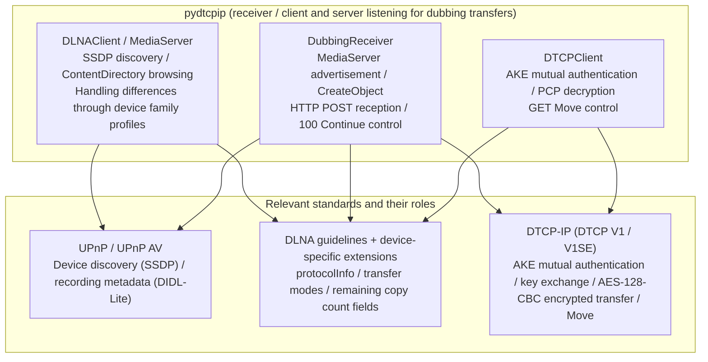
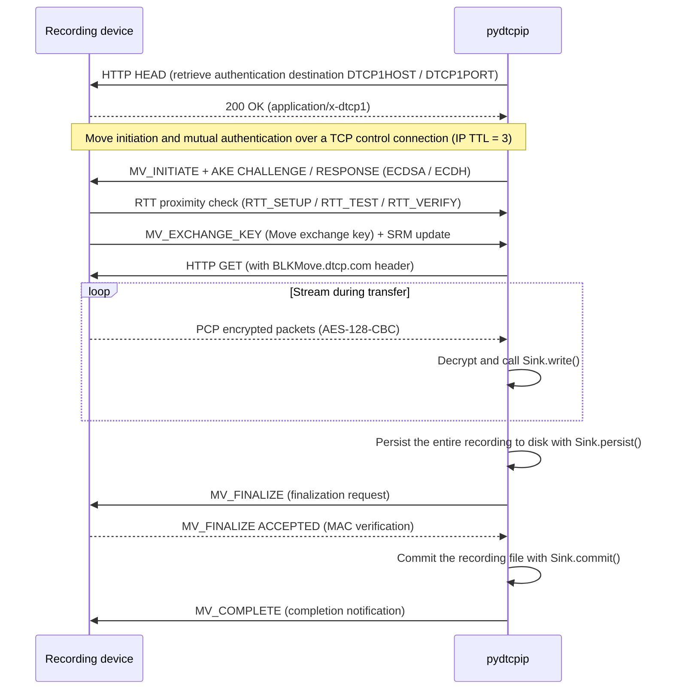

<!-- omit in toc -->
# pydtcpip - Unofficial Python implementation of DTCP-IP with DLNA/UPnP support

[](https://pypi.org/project/pydtcpip/)
[](https://pypi.org/project/pydtcpip/)
[](https://github.com/tsukumijima/pydtcpip/actions/workflows/ci.yml)

**pydtcpip is an open-source, cross-platform Python library that can transfer broadcast recordings stored on Japanese home TVs and BD / HDD recorders to a PC using DLNA / UPnP / DTCP-IP.**

It can handle the entire process from device discovery and recording listings to mutual authentication, decryption, Move transfers, listening for incoming dubbing transfers, and streaming reception.  
Transfer quality is set to lossless by default, allowing recordings to be received without re-encoding at the quality stored on the recording device (preserving the broadcast MPEG-2 format for recordings in DR (Direct Recording) mode).  
The library itself is designed as an asynchronous (asyncio) library for integration into applications, and it also includes a reference CLI implementation (`pydtcpip`) for operation checks and research.

The publicly available partial DTCP-IP specifications (Informational Version) omit the cryptographic parameters and details of some functions needed for implementation, and **for more than 20 years since the specification was established, there had been no open-source implementation that integrated DLNA / UPnP discovery, mutual authentication, decryption, and Move.**

pydtcpip is a foundation library for recovering broadcast recordings from aging recording devices and continuing to archive them as the industry as a whole declines, and it also serves as research material that clarifies the technical details of DLNA / DTCP-IP implementations in Japanese recording devices and DTCP-IP-compatible remote viewing applications.

> [!NOTE]  
> **This project is an independent, unofficial implementation, separate from manufacturers' official software.**  
> It has no affiliation, endorsement, or certification relationship with the licensing administrator (DTLA), other standards organizations, or device manufacturers.  
> The source code license does not grant third-party patent or trademark licenses relating to DTCP-IP or other technologies, nor does it provide any warranty of non-infringement.

- [Main features](#main-features)
- [Supported devices](#supported-devices)
  - [Model-specific notes](#model-specific-notes)
  - [Family profiles](#family-profiles)
- [Installation](#installation)
- [Using the reference CLI implementation](#using-the-reference-cli-implementation)
  - [1. Preparing credentials](#1-preparing-credentials)
  - [2. Checking recording devices and program information](#2-checking-recording-devices-and-program-information)
  - [3. Saving recordings from a PC through Move transfers](#3-saving-recordings-from-a-pc-through-move-transfers)
  - [4. Browsing recorders and moving recordings interactively](#4-browsing-recorders-and-moving-recordings-interactively)
  - [5. Streaming playback](#5-streaming-playback)
  - [6. Receiving recordings as a dubbing destination](#6-receiving-recordings-as-a-dubbing-destination)
  - [7. Running without interaction](#7-running-without-interaction)
  - [8. Firewall and network settings](#8-firewall-and-network-settings)
- [Using pydtcpip as a Python library](#using-pydtcpip-as-a-python-library)
- [Received data format and metadata](#received-data-format-and-metadata)
- [Device-specific behavior and contributing to compatibility](#device-specific-behavior-and-contributing-to-compatibility)
- [Research material](#research-material)
  - [Why recordings need to be recovered from devices now](#why-recordings-need-to-be-recovered-from-devices-now)
  - [What is DTCP-IP?](#what-is-dtcp-ip)
    - [The relationship between UPnP / DLNA and DTCP-IP, and the structure shared with mTLS](#the-relationship-between-upnp--dlna-and-dtcp-ip-and-the-structure-shared-with-mtls)
    - [Structural correspondence with B-CAS / ARIB STD-B25 decryption](#structural-correspondence-with-b-cas--arib-std-b25-decryption)
  - [Implemented specifications and design principles](#implemented-specifications-and-design-principles)
  - [Structural issues in the protection model revealed by research](#structural-issues-in-the-protection-model-revealed-by-research)
    - [What mutual authentication proves and the boundary after decryption](#what-mutual-authentication-proves-and-the-boundary-after-decryption)
    - [Clients for general-purpose operating systems and types of online key distribution](#clients-for-general-purpose-operating-systems-and-types-of-online-key-distribution)
    - [Can revocation lists (SRMs) be operated effectively?](#can-revocation-lists-srms-be-operated-effectively)
    - [The spread of LLM agents and the limits of protection through secrecy](#the-spread-of-llm-agents-and-the-limits-of-protection-through-secrecy)
  - [Summary](#summary)
- [License](#license)

## Main features

- **Asynchronous Python library (`DLNAClient`, `DTCPClient`, `DubbingReceiver`)**: DTCP-IP reception can be integrated into any Python application through Pydantic models and type-safe events
- **Home device discovery and metadata retrieval**: Discovery of recording devices (DLNA media servers) through SSDP, and retrieval of program information and copy control information by browsing directories (reference CLI implementation: `discover` / `info`)
- **Client-initiated Move transfers (copying and moving under Dubbing 10 (ダビング10))**: Implements mutual authentication, decryption, finalization (`FINALIZE`) after persisting the destination data, and completion (`COMPLETE`), with the ability to resume finalization alone after a disconnection without receiving the data again (`move` / `resume`)
- **Interactive interface combining discovery, program information and Move transfers**: The functions of `discover`, `info`, `move` and `resume` on one screen, showing recorders, folders, program information, qualities, sizes and copy counts side by side and moving several selected recordings in sequence (`tui`)
- **Streaming reception without consuming the copy count**: Data delivery with backpressure control through asynchronous callbacks, and transfer to FFplay or similar tools through standard output (`stream`)
- **Listening for incoming dubbing transfers as a DTCP-IP-compatible NAS**: Reception of recordings and program information from TVs and recorders that have no streaming functionality and only support push dubbing started from the device's own menu (送り出しダビング) (`receive`)
- **Diagnostic data export**: Export of protocol responses from unsupported models with identifying information and program titles masked for troubleshooting and pull requests (`dump --mask-private`)

Transfers select the main recording in its stored quality, using `DLNA.ORG_CI` and family-specific metadata to distinguish it from converted and mobile versions. An AVC or nasne three-times recording is transferred in that recorded format; original quality does not require DR mode. Dedicated Move resources are preferred for dubbing and excluded from streaming selection, including explicit selection with `--resource`.

`info` numbers resources in the order advertised by the device, identifies the default streaming and Move selections, and distinguishes the main recording from converted or mobile versions. It displays device-provided mode names when available, together with reported resolution, codec and bitrate, such as `1280x720 (AVC / 3 Mbps)`. If the device supplies insufficient information, the CLI warns that the selected resource's quality is unknown.

To select a resource explicitly, pass its number from `info` as `--resource N` to `stream` or `move` for the same recording. Alternatively, pass its URL to `stream URL` or `move recording.m2ts --url URL`. Resource numbers and direct URLs are mutually exclusive; `--resource` cannot be combined with a URL.

## Supported devices

**The table distinguishes discovery and metadata retrieval from successful media transfers.**  
“Verified” denotes maintainer testing; “Reported” denotes community testing linked from the model name. “Unverified” means that no successful test of that operation has been recorded, rather than that the device is incompatible.

Models are grouped by device family, with older models first within each group. Sony and Buffalo nasne models are grouped together as one series.

| Model / report | Discovery | Recording listings | Streaming (non-Move) | Move | Push dubbing reception |
| --- | --- | --- | --- | --- | --- |
| [Sony nasne CECH-ZNR1J](https://github.com/tsukumijima/pydtcpip/issues/21) | Reported | Reported | Reported | [Reported](https://github.com/tsukumijima/pydtcpip/pull/25) | Not supported |
| [Sony nasne CECH-ZNR2J](https://github.com/tsukumijima/pydtcpip/issues/34) | Unverified | Reported | Reported | [Reported](https://github.com/tsukumijima/pydtcpip/issues/34#issuecomment-7191012829) | Unverified |
| [Sony nasne (model unspecified)](https://github.com/tsukumijima/pydtcpip/issues/16) | Reported (API) | Reported (API) | Reported (DR and 3x, API) | [Reported](https://github.com/tsukumijima/pydtcpip/issues/16#issuecomment-6994279457) | Unverified |
| [Buffalo nasne NS-N100](https://github.com/tsukumijima/pydtcpip/issues/4) | Reported ([see note](#model-specific-notes)) | Reported | Unverified | Unverified | Not supported |
| [Toshiba REGZA 42ZG1](https://github.com/tsukumijima/pydtcpip/issues/22) | Not detected | Unverified | Unverified | Unverified | Reported |
| [Toshiba REGZA 50Z740XS](https://github.com/tsukumijima/pydtcpip/issues/34) | Unverified | Reported | Reported (including time-shift recordings) | [Reported directly from time-shift recordings](https://github.com/tsukumijima/pydtcpip/issues/34#issuecomment-7191012829) | Unverified |
| Toshiba REGZA 43Z570L | Verified | Verified | Verified | Refused to start | Verified |
| [Toshiba REGZA 43M550M](https://github.com/tsukumijima/pydtcpip/issues/8) | Reported | Reported | [Authentication and start of reception reported](https://github.com/tsukumijima/pydtcpip/issues/8#issuecomment-7187026479) | Unverified | Unverified |
| [Toshiba RD-BR600](https://github.com/tsukumijima/pydtcpip/issues/31) | Unverified (direct URL used) | Reported | Reported (full recording, API) | Unverified | Unverified |
| Toshiba DBR-Z620 | Verified | Verified | Verified | Verified | Verified |
| [Toshiba REGZA DBR-4KZ200](https://github.com/tsukumijima/pydtcpip/issues/19) | Reported | Reported (including time-shift recordings) | Unverified | Unverified | Unverified |
| [Toshiba REGZA DBR-M4010](https://github.com/tsukumijima/pydtcpip/issues/34) | Unverified | Reported | Reported (including time-shift recordings) | [Reported](https://github.com/tsukumijima/pydtcpip/issues/34#issuecomment-7191012829) (save time-shift recordings to USB HDD first) | Unverified |
| [Panasonic TZ-WR500P](https://github.com/tsukumijima/pydtcpip/issues/33) | Reported | Reported | Full recording saved | Media request refused (HTTP 503) | Unverified |
| [Panasonic VIERA TH-65LX950](https://github.com/tsukumijima/pydtcpip/issues/14#issuecomment-7005316755) | Reported | Reported | Reported | Refused to start | Reported |
| [Panasonic VIERA TV-43W90B](https://github.com/tsukumijima/pydtcpip/issues/32) | Reported | Reported | Full recording saved in standby | Refused to start | Unverified |
| [Panasonic DMR-BXT3000](https://github.com/tsukumijima/pydtcpip/issues/7) | Reported | Reported | Unverified | Unverified | Unverified |
| [Panasonic DMR-BRX/BCX2060](https://github.com/tsukumijima/pydtcpip/issues/6) | Reported | Reported | [Full recording saved](https://github.com/tsukumijima/pydtcpip/issues/11) | Unverified | Unverified |
| [Panasonic DMR-BRW1060](https://github.com/tsukumijima/pydtcpip/issues/20) | Reported | Reported ([see note](#model-specific-notes)) | [Full recording saved](https://github.com/tsukumijima/pydtcpip/issues/20#issuecomment-7157451142) | [Reported](https://github.com/tsukumijima/pydtcpip/issues/20#issuecomment-7157451142) | Unverified |
| [Panasonic DMR-2W101](https://github.com/tsukumijima/pydtcpip/issues/11) | External script only | Reported (API) | Full recording saved | Unverified | Unverified |
| [Panasonic DIGA DMR-2W202](https://github.com/tsukumijima/pydtcpip/pull/37) | Reported | Reported ([see note](#model-specific-notes)) | Reported | Reported | Unverified |
| [Panasonic DIGA DMR-4SE102](https://github.com/tsukumijima/pydtcpip/issues/26) | Reported | Reported | Unverified (4K advertises DTCP2) | Unverified | Unverified |
| [Panasonic DIGA DMR-4TS204](https://github.com/tsukumijima/pydtcpip/issues/27) | Reported | Reported | Reported | Reported (including final Move) | Unverified |
| [Panasonic DIGA DMR-4TS204S](https://github.com/tsukumijima/pydtcpip/issues/15) | Reported | Reported | Reported | Reported | Unverified |
| [Sony BDZ-ZW1500](https://github.com/tsukumijima/pydtcpip/issues/2) | Reported | Reported | Reported (10 seconds) | Unverified | Unverified |
| [Sony BDZ-FBT2200](https://github.com/tsukumijima/pydtcpip/issues/12) | Unverified | Reported (API) | Reported | Unverified | Unverified |
| [Sony PC TV Plus](https://github.com/tsukumijima/pydtcpip/issues/13) | Unverified | Reported with fresh connections | Reported (full recordings, API) | Unverified | Unverified |
| [Sharp AQUOS BD-W2700](https://github.com/tsukumijima/pydtcpip/issues/1) | Reported | Reported | Unverified | Unverified | Unverified |
| [Synology DS1520+ / sMedio DTCP Move](https://github.com/tsukumijima/pydtcpip/issues/28) | Reported | Reported | [Reported](https://github.com/tsukumijima/pydtcpip/pull/29) (select a recording to use its metadata) | Unverified | Unverified |

If discovery fails on Windows, select your PC's LAN address with `--interface`.

### Model-specific notes

- **Sony and Buffalo nasne**
  - Start transfers from the PC.  
    The [nasne HOME migration feature](https://www.buffalo.jp/s3/guide/ns-n100/04/ja/recorder/dubbing.html) requires the destination nasne to start the transfer.
  - For GET Move from a Sony nasne, select the recorder from the device list or specify its description URL with `--server`.
    If a Python application calls `DTCPClient.move()` directly, pass `reconnect_without_authentication=True` for this source.
- **Buffalo nasne NS-N100**
  - If the nasne stops answering discovery requests, run `pydtcpip discover --timeout 35` to give its periodic announcements time to arrive.  
    The TUI listens for these announcements in the background and lists the initial search results as soon as they are ready.
  - If the nasne disappears from discovery even with the correct `--interface`, it may still be reachable by its device description URL.  
    Pass the URL to `info --server`.  
    In the TUI, press `+` and enter the URL.  
    See the reports for [Windows](https://github.com/tsukumijima/pydtcpip/issues/4#issuecomment-6960981018) and [macOS](https://github.com/tsukumijima/pydtcpip/issues/17).
  - Copy-controlled recordings received through nasne HOME migration have only the final Move available.  
    pydtcpip displays `Copies remaining: 0` for these recordings because the count excludes that final Move.  
    A successful final Move deletes the recording from the source nasne.
- **REGZA TVs**
  - For the 43Z570L, run `receive` on the PC and start dubbing from the TV.  
    In testing, the TV refused to start a Move initiated from the PC.
  - Other REGZA TV models may also support only dubbing initiated from the TV.
  - For dubbing from the 50Z740XS's own menu, the [manual (p. 147)](https://cs.regza.com/document/manual/100016_07r0.pdf#page=147) directs users to save a time-shift recording to a normal recording drive first.
- **Panasonic VIERA TV-43W90B**
  - If media requests return HTTP 503 while the TV is on, try streaming in standby.  
    The TV's recording list remained available in both states, and 4K recordings were absent from the network listing.
- **Panasonic DMR-BRW1060**
  - Protected folders can return UPnP error 720 even with home streaming enabled and the PC allowed on the recorder.  
    If this occurs, `dump` records the response and continues with other folders. The recording list can be accessed without DTCP-IP credentials when the recorder allows it.
- **Panasonic DIGA DMR-2W202**
  - Live tuner channels and separately stored mobile versions appear beside recordings. A mobile version advertises only a 640x360 resource and is not selected by default; pass `--resource 1` to transfer it explicitly.
- **Panasonic DIGA DMR-4TS204**
  - 4K originals use DTCP2. The advertised 2K conversions returned HTTP 503 in the [streaming tests](https://github.com/tsukumijima/pydtcpip/issues/27#issuecomment-7071794483).
- **Panasonic DIGA DMR-4TS204S**
  - If `info` lists only converted resources for a recording, choose a resource number from that list.  
    Pass it to `stream` or `move` as `--resource N` for the same recording.
- **Sony PC TV Plus**
  - `DLNAClient()` opens a fresh TCP connection for each SOAP request.  
    A caller-supplied `aiohttp.ClientSession` keeps its own connector settings.  
    Set `aiohttp.TCPConnector(force_close=True)` on that session for PC TV Plus.

### Family profiles

Details of the implemented specification scope and design principles are summarized in [Implemented specifications and design principles](#implemented-specifications-and-design-principles) later in this document.

**Family profiles provide the metadata support listed below; transfer results are recorded separately in the table above.**  
Profiles marked as unverified in the CLI still require hardware validation of their family-specific parsing and optional queries. A successful basic transfer on a model does not verify every feature of its profile.

All profiles retain standard recording metadata, media resource attributes and device-provided extension fields. The table lists additional interpretation and queries; fields and services must be supplied by the device to be available.

| Family | Profile | Metadata support |
| --- | --- | --- |
| Sony / Buffalo nasne | `nasne` | Copy counts, extended recording details, thumbnails, estimated chapter positions, and identification of DR, three-times and mobile versions and Move resources |
| Toshiba / TVS REGZA TVs | `toshiba_regza_tv` | Toshiba metadata support below, plus broadcast network and service IDs available only in recording listings |
| Toshiba / REGZA recorders | `toshiba` | Copy counts, frame rates, chapter queries and USB drive names from recording folders |
| Panasonic DIGA / VIERA | `panasonic` | Resource copy counts, chapters, recording-mode names, and identification of converted resources from URLs, HD/VGA references and alternative resource elements |
| Sony BDZ | `sony_bdz` | Copy counts, chapters, recording details, actual recording start, storage information and identification of main and mobile recording versions |
| Sony PC TV Plus | `sony_pctv` | Copy counts from Sony metadata |
| Sharp AQUOS | `sharp` | Copy counts and chapters; recording-mode and other Sharp fields retained as extension metadata |
| I-O DATA REC-ON | `recon` | Resource copy counts, chapters through an advertised tag action and recording details from compatible services |
| I-O DATA RECBOX | `recbox` | Sony, Toshiba, Sharp and Panasonic copy counts, plus Sony, Sharp and Panasonic chapters retained by the server |
| Buffalo LinkStation | `linkstation` | Sony, Toshiba, Sharp and Panasonic copy counts, plus Sony, Sharp and Panasonic chapters retained by the server |
| Cable / satellite set-top boxes | `stb` | Resource copy counts, advertised chapter tags and compatible recording-detail services |
| Compatible Hikari TV boxes | `stb_hikaritv` | Set-top box metadata and the dedicated recording container |
| STW2000 | `stb_stw2000` | Set-top box metadata and the STW2000 recording container |
| AM900 | `stb_am900` | Set-top box metadata and the AM900 recording container |
| Standard DLNA servers | `generic` | Standard recording and resource metadata, with device-provided extension fields retained without family-specific interpretation |

> [!IMPORTANT]  
> **DTCP-IP itself is a standard that defines mutual authentication and encrypted transfer, while recording listings and protection information are exchanged through DLNA / UPnP at the preceding stage.**  
> However, **the details of this preceding stage depend heavily on manufacturer- and model-specific extensions; for example, even the field names for the remaining Dubbing 10 copy count are not standardized across manufacturers.** Even commercial recorders frequently encounter interoperability problems with each other.  
> For this reason, models not listed above may work as they are, or they may require additional support.
> 
> pydtcpip isolates these device-dependent behaviors in library modules called "profiles" so that issues specific to a particular recording device can be addressed easily without affecting other recording devices.  
> **If pydtcpip does not work with your TV or recorder, please see [Device-specific behavior and contributing to compatibility](#device-specific-behavior-and-contributing-to-compatibility) below to fix device support on your hardware and submit a pull request.**

## Installation

Python 3.13 or later is required.  
Please install it with [uv](https://docs.astral.sh/uv/) or pip.

```bash
# To install with the CLI
$ uv tool install pydtcpip

# Alternatively, with pip
$ pip install pydtcpip
```

To integrate it as a library into another project, you can add it with `uv add pydtcpip` (for projects using uv).  
To develop or run it from source, run `uv sync` in the repository, then launch it with `uv run pydtcpip --help`.

## Using the reference CLI implementation

pydtcpip itself is an asynchronous Python library for integration into applications.  
The bundled `pydtcpip` command was developed as a reference implementation for operation checks and research, with the aim of checking connectivity to real devices and validating the protocol.  
It implements the functions needed to transfer recorded data, including an interactive interface that combines device discovery, program information and Move transfers, a progress bar showing transfer progress, and a resume function for interrupted transfers.

### 1. Preparing credentials

> [!IMPORTANT]  
> **Receiving recordings requires a DTCP device certificate (88 bytes) and its corresponding per-device private key (20 bytes).**  
> This package provides only the protocol implementation and does not include a device certificate or per-device private key. Please prepare your own credentials.

When using the CLI, placing `credentials.env` once in the default data directory for your OS is convenient.  
It is loaded automatically at startup, so you do not need to specify the file every time you run a command.

| OS | Default data directory |
| --- | --- |
| Linux and others | `$XDG_DATA_HOME/pydtcpip/` (`~/.local/share/pydtcpip/` if unset) |
| macOS | `~/Library/Application Support/pydtcpip/` |
| Windows | `%APPDATA%\pydtcpip\` (`C:\Users\<username>\AppData\Roaming\pydtcpip`) |

Enter the following two items in `credentials.env` as hexadecimal strings.

```dotenv
PYDTCPIP_CERTIFICATE=device_certificate_as_a_hexadecimal_string
PYDTCPIP_PRIVATE_KEY=per_device_private_key_as_a_hexadecimal_string
```

You can also specify them through environment variables with the same names (`PYDTCPIP_CERTIFICATE`, `PYDTCPIP_PRIVATE_KEY`), and **environment variable values take precedence over the file**.  
Because the file contains a private key, restrict its read and write permissions to your own user account (`chmod 600` on Linux / macOS).

To specify another file, use the `--credentials` (`-c`) option; to change the entire storage directory, specify `--data-dir` before the subcommand.

```bash
$ pydtcpip move recording.m2ts --credentials /path/to/credentials.env
$ pydtcpip --data-dir /path/to/device-data move recording.m2ts
```

> [!TIP]  
> **SRM (System Renewability Message)** is a device certificate revocation list signed by DTLA.  
> After initially authenticating with SRM version 0, pydtcpip automatically saves a newer SRM received from the connected recording device as `srm.bin` in the default data directory or the directory specified with `--data-dir`.  
> On subsequent connections, it uses the saved `srm.bin` for mutual authentication with the recording device.  
> For this reason, you do not need to prepare an SRM in advance to use pydtcpip.

### 2. Checking recording devices and program information

Connect your PC to the same home network as the recording device and run discovery.  
If you omit the device URL or recording ID, a table of entries appears in the terminal, and you can select an entry by number.

```bash
# List recording devices on the home network and their device description URLs
$ pydtcpip discover
                                                  Recorders
┏━━━━━━━━━━━━━━━┳━━━━━━━━━━━━━━━━━━━┳━━━━━━━━━┳━━━━━━━━━━━━━━━━━━┳━━━━━━━━━━━━━━━━━━━━━━━━━━━━━━━━━━━━━━━━━━━┓
┃ Name          ┃ Manufacturer      ┃ Model   ┃ Profile          ┃ Device description URL                    ┃
┡━━━━━━━━━━━━━━━╇━━━━━━━━━━━━━━━━━━━╇━━━━━━━━━╇━━━━━━━━━━━━━━━━━━╇━━━━━━━━━━━━━━━━━━━━━━━━━━━━━━━━━━━━━━━━━━━┩
│ REGZA-43Z570L │ TOSHIBA TVS REGZA │ 43Z570L │ toshiba_regza_tv │ http://192.168.1.73:20003/description.xml │
│ DBR-Z620      │ TOSHIBA           │ DBRZ6   │ toshiba          │ http://192.168.1.44:55247/dms/            │
└───────────────┴───────────────────┴─────────┴──────────────────┴───────────────────────────────────────────┘
```

Run `pydtcpip info` to select a recorder and recording interactively, or specify both directly as below. This example uses synthetic recording metadata; the available fields and quality options depend on the device.

```text
$ pydtcpip info --server http://192.0.2.20:5000/description.xml --id V_42 --basic
Profile: generic
                                 Example recording
┌───────────────────────────────────────────────┬─────────────────────────────────┐
│ ID                                            │ V_42                            │
│ Date                                          │ 2026-01-01T20:00:00+09:00       │
│ Duration                                      │ 0:30:00.000                     │
│ Channel                                       │ Example channel                 │
│ Copies remaining (recording metadata)         │ Unsupported format              │
│ Selected resource Move support (protocolInfo) │ Yes                             │
│ Transfer copy control                         │ Available after transfer starts │
│ Resource 1                                    │ 1920x1080 (MPEG-2 / 18 Mbps)    │
│ Resource 1: Recording version                 │ Original recording              │
│ Resource 1: DLNA.ORG_PN                       │ DTCP_MPEG_TS_JP_T               │
│ Resource 1: Default selection                 │ Streaming, Move                 │
│ Resource 1: Duration                          │ 0:30:00.000                     │
│ Resource 2                                    │ 1280x720 (AVC / 3 Mbps)         │
│ Resource 2: Recording version                 │ Converted or mobile version     │
│ Resource 2: DLNA.ORG_PN                       │ DTCP_AVC_TS_JP_AAC_T            │
│ Resource 2: Duration                          │ 0:30:00.000                     │
└───────────────────────────────────────────────┴─────────────────────────────────┘
```

`info` also displays scheduled broadcast times, video/audio information, original copy-count values and available chapters. Sony-compatible services and nasne can supply additional recording details.  
Optional queries run by default; a failed query is reported while the available program information remains visible. Use `--basic` to read only the ordinary listing, or `--json` to export the collected metadata, source responses and query statuses.

```bash
pydtcpip info --basic
pydtcpip info --json --server http://192.0.2.20:5000/description.xml --id RECORDING_ID
```

Finite copy counts are displayed excluding the final Move: a device count of 10 becomes nine copies, and a count of 1 means only the final Move remains.  
The original field and value are also retained. Missing values remain unknown, and unlimited-copy markers are kept separate from finite counts.

### 3. Saving recordings from a PC through Move transfers

**The `move` subcommand connects to the recording device as a client and saves the entire recording through a GET Move operation.**  
This method is completed entirely through operations on the PC (client), without requiring remote control operations on the recording device.  

```bash
$ pydtcpip move recording.m2ts
```

To choose a different quality, inspect the same recording with `info`, then pass its resource number. For example, `pydtcpip move recording.m2ts --resource 2` uses resource 2 after interactive recording selection. Omit `--resource` to use the default stored recording.

Recordings that the device reports as protected (`upnp:writeStatus` is `PROTECTED`) are not moved; release the protection on the recording device first.  
If the device refuses to start a Move, for example while it is recording, `move` fails before any data is transferred and no copy is consumed; try again later.

> [!NOTE]  
> **Some recording device models do not store program information or time information in the SIT (Selection Information Table) of MPEG2-TS recordings (partial TS).**  
> This information generally appears to be stored in recordings made on REGZA TVs.
> 
> **The CLI saves program information as XML and JSON sidecars before transferring the recording.**  
> For `recording.m2ts`, these files are `recording.xml` and `recording.metadata.json` in the same directory. The JSON also contains available chapters, additional recording details and their acquisition status.  
> The available information depends on the device; see [Received data format and metadata](#received-data-format-and-metadata) for the contents of each file.

> [!WARNING]  
> **A Move operation consumes one copy from the source's copy count.**  
> Before a Move operation runs, a confirmation screen appears together with the recording title and the remaining copy count.  
> For recordings with no copies remaining and only a final move available, or recordings such as Copy Once (コピーワンス) recordings that prohibit further copying and permit only a move, this operation deletes the source recording, and it cannot be restored. Please exercise sufficient caution.

During reception, data is written to a temporary file (`.recording.m2ts.part`), and finalization (`FINALIZE`) is requested from the source only after persistence to disk is complete.  
If the transfer is interrupted before finalization is requested, the Move is canceled and the temporary file is deleted, so the source's copy count does not decrease.

> [!TIP]  
> **If a response cannot be received because of a disconnection or similar issue after the finalization request has been sent, the received data and resume information (`recording.m2ts.pydtcpip-resume.json`) are saved.**  
> Once communication is restored, use the following command to resume only finalization without receiving the data again.
> 
> ```bash
> $ pydtcpip resume recording.m2ts
> ```
>
> Depending on the source model, the device may immediately discard its resume information and reject retransmission if the connection is lost during finalization (observed on DBR-Z620).  
> In that case, pydtcpip deletes the resume information and saves the received video in `.recording.m2ts.part`.  
> If the source's remaining copy count has decreased or the recording has been deleted, the Move has already been finalized on the source.

### 4. Browsing recorders and moving recordings interactively

<br>

**The `tui` subcommand provides the functions of `discover`, `info`, `move` and `resume` together in an interactive interface.**  
Recorders found on the network appear on the left, the folders and recordings of the selected recorder in the middle, and details of the highlighted recording on the right.  
For streaming to a player, receiving push dubbing or exporting diagnostics, use `stream`, `receive` or `dump` directly.

```bash
# Save moved recordings in the current directory
$ pydtcpip tui
# Save moved recordings in another directory
$ pydtcpip tui ~/Videos
```

The recording table shows the date, length, quality, size and remaining copies of each recording, using the resource that a Move would transfer.  
Sizes marked `~` are estimated from the advertised bitrate and duration, and sizes marked `*` are the encrypted transfer size because the device did not report the saved size.  
When the cursor rests on a recording, the details pane also shows every advertised quality, chapters and additional program information from the device.

| Key | Action |
| --- | --- |
| `Enter` / `Backspace` | Open the highlighted recorder or folder / return to the parent folder |
| `Space` / `a` | Select or deselect the highlighted recording / every recording in the folder |
| `v` | Choose another quality for the highlighted recording (the stored recording is used by default) |
| `m` | Review and move the selected recordings |
| `/` / `s` | Filter titles in the folder / change the sort order |
| `c` | Cancel the active transfer before finalization |
| `+` | Add a recorder by its device description URL when discovery does not find it |
| `l` / `q` | Show the log / quit |

Selected recordings are marked with `■` (yellow when another quality is chosen), and the same column shows the state of recordings queued during the session: `Q` queued, `M` moving, `D` done, `R` finalization must be resumed, `C` the source rejected finalization, `F` failed and `S` stopped.  
To filter while a Japanese input method is in kana mode, `・` and `／` also open the title filter.

The mouse works as in htop: a click moves the cursor, a double click opens or selects the row, the wheel moves the cursor, and clicking a column heading sorts by that column.

`m` opens a confirmation listing each recording with its copy count, size and destination file, together with warnings for recordings that only have the final Move left, unknown copy counts and versions other than the stored recording.  
Recordings are saved as `<title>-<identifier>.m2ts` in the directory given to `tui`, which can also be changed on the confirmation screen, with the same XML and JSON metadata files as the `move` subcommand, and are transferred one at a time.  
Recordings whose destination files already exist and recordings that the device reports as protected are excluded, and a recording listed in several folders is moved only once.

> [!WARNING]  
> **Each Move consumes one copy from the source, and a recording with only the final Move left, or one that prohibits copying, is deleted from the source.**  
> Check the warnings on the confirmation screen before starting.

If a Move does not complete, the queue pauses and explains whether the source may have consumed a copy.

If the source refuses to start a Move and offers an original-quality stream, choose **Save in original quality**. The source recording and its copy count stay unchanged. The queue labels the result **Saved via stream**.
To save later recordings from the same device without another prompt if their Moves are also refused, select the checkbox before saving. The choice applies only to the current queue.

A Move interrupted after finalization was requested appears in the transfer list as requiring resumption; press `Enter` on it to finalize without receiving the recording again.  
Sources that discard their resume information after a disconnection during finalization, such as DBR-Z620, reject this resumption; see the note in [section 3](#3-saving-recordings-from-a-pc-through-move-transfers) for what is kept and how to check whether the Move was finalized.  
Quitting during finalization waits until it finishes, and quitting during reception asks before cancelling the transfer, which keeps the copy on the source.

The interface needs a terminal. For scripts and other non-interactive use, use the subcommands.

### 5. Streaming playback

**The `stream` subcommand provides functionality equivalent to recorded program streaming playback in DTCP-IP-compatible remote viewing applications. It decrypts the MPEG-2 TS stream sent by the recording device as it arrives and writes it to standard output.**  
Because logs, progress bars, and selection screens are all written to standard error, you can pipe the stream to an external MPEG2-TS-compatible player such as FFplay for streaming playback.

The following command is an example of streaming a program selected interactively on the recorder, using FFplay for deinterlacing and libaribcaption to display subtitles in [ARIB STD-B24](https://www.arib.or.jp/kikaku/kikaku_hoso/desc/std-b24.html) format (ARIB subtitles).  

```bash
$ pydtcpip stream | ffplay -loglevel panic -nostats -autoexit \
  -vf 'yadif=mode=send_field:parity=auto:deint=interlaced' \
  -scodec libaribcaption -sub_type bitmap \
  -i pipe:0
```

> [!NOTE]  
> The FFmpeg / FFplay packages provided by Linux distributions may not include [libaribcaption](https://github.com/xqq/libaribcaption), which is required to display ARIB subtitles.  
> [FFmpeg-Builds](https://github.com/FFmpeg-Builds/FFmpeg-Builds) distributes FFmpeg builds that include libaribcaption, so we recommend using those builds.

> [!TIP]  
> You can specify the time range to receive in milliseconds with the `--start-ms` and `--end-ms` options.  
> This functionality is primarily provided for implementing seeking when using the library, but it is also available through the CLI.  
> The range returned by the device may extend before or after the specified positions, and the decoder may produce warnings at the first and last frame boundaries.

### 6. Receiving recordings as a dubbing destination

**For recording devices that only support push dubbing from their own menus, you can receive recorded data by using the `receive` subcommand to have the PC listen as a DTCP-IP-compatible NAS (DTCP-IP-compatible DLNA server).**

Specifying a destination directory starts listening on all IPv4 network adapters.  
The destination IP address announced to recording devices is set automatically, so specifying an IP address or selecting a device is normally unnecessary.

```bash
$ pydtcpip receive recordings
```

If you want to listen only on a specific network adapter, such as Wi-Fi, specify that adapter's IPv4 address on the PC with `--interface`.  
To allow reception only from specific recording devices, you can specify their IPv4 addresses with `--source` (multiple values are allowed). Both options only need to be specified when necessary.

```bash
$ pydtcpip receive recordings --interface 192.0.2.10
$ pydtcpip receive recordings --source 192.0.2.20
```

Once the server starts, use the recording device's remote control to select the recorded program for dubbing on its screen, then select "pydtcpip" as the dubbing destination and start dubbing.  

> [!NOTE]  
> **Received recordings are saved as `.m2ts`, with program metadata in `.xml` and `.metadata.json` sidecars in the specified directory.**  
> Incoming transfers preserve the metadata supplied by the sender, including its original XML. Additional source queries require a discovered media server and are available through `info` and client-initiated `move`.  
> The program title provided through DLNA is normally used as the filename.  
> To stop the server from listening, press Ctrl+C.

> [!WARNING]  
> **As with the `move` subcommand, dubbing consumes one copy from the source's copy count.**  
> For recordings with no copies remaining and only a final move available, or recordings such as Copy Once recordings that prohibit further copying and permit only a move, this operation deletes the source recording, and it cannot be restored. Please exercise sufficient caution.

### 7. Running without interaction

For batch execution and similar uses, you can skip interactive selection by specifying the URL of the recording device's DTCP-IP-compatible DLNA server with `--server` (`-s`) and the recording ID with `--id`.

Interaction is also skipped when standard input is not a terminal, but we recommend specifying `--server` explicitly for automated execution to avoid selecting the wrong device.  
To also skip the confirmation before the `move` subcommand runs, add `--yes` (`-y`).

```bash
$ pydtcpip info --server http://192.0.2.20:5000/description.xml --id RECORDING_ID
$ pydtcpip move recording.m2ts --server http://192.0.2.20:5000/description.xml --id RECORDING_ID --yes
$ pydtcpip stream --server http://192.0.2.20:5000/description.xml --id RECORDING_ID | ffplay -loglevel panic -nostats -autoexit \
  -vf 'yadif=mode=send_field:parity=auto:deint=interlaced' \
  -scodec libaribcaption -sub_type bitmap \
  -i pipe:0
```

To select a particular quality in a script, use the number shown by `info` for that recording. The following examples select resource 2 for each operation; a resource marked `Move only` is available to `move`, but not to `stream`.

```bash
$ pydtcpip move recording.m2ts --server http://192.0.2.20:5000/description.xml --id RECORDING_ID --resource 2 --yes
$ pydtcpip stream --server http://192.0.2.20:5000/description.xml --id RECORDING_ID --resource 2 | ffplay -loglevel panic -nostats -autoexit \
  -vf 'yadif=mode=send_field:parity=auto:deint=interlaced' \
  -scodec libaribcaption -sub_type bitmap \
  -i pipe:0
```

> [!NOTE]  
> If the URL of the served resource is known, you can also specify it directly, as in `stream URL` or `move recording.m2ts --url URL --yes`.  
> Use either `--resource N` with a recording or a direct URL; combining them is an error.
> When you specify a URL directly, the DLNA recording listing is not retrieved, so program metadata sidecars and the remaining copy count from metadata are unavailable.  

### 8. Firewall and network settings

Unicast discovery responses use UDP port 57000.  
Device announcements and incoming dubbing discovery use UDP port 1900.  
Incoming dubbing transfers use TCP port 57000.  
If your firewall is enabled, allow incoming traffic from your home network (adjust the address range to match your home environment).

The following command is an example of allowing listening on port 57000 in an environment with UFW enabled.

```bash
$ sudo ufw allow from 192.0.2.0/24 to any port 57000
```

> [!NOTE]  
> UFW allows incoming multicast traffic on UDP port 1900 by default, but if you use custom rules, please allow it as well.

> [!TIP]  
> By default, discovery runs simultaneously on each IPv4 network, even when wired LAN and Wi-Fi are both in use. To limit discovery to a particular network, you can specify the PC's IPv4 address with the `--interface` option as shown below.  
> You can change the discovery port with `--search-port` before the subcommand (`0` lets the OS assign a port automatically).
> Use a response port other than UDP 1900 if you want the `discover` command to listen for announcements as well.
>
> ```bash
> $ pydtcpip --interface 192.0.2.10 discover
> ```

## Using pydtcpip as a Python library

All public APIs assume asyncio (asynchronous I/O).

If you want to manage credentials and SRMs in the same format as the CLI, explicitly create and use a `DeviceStore`.  
`DeviceStore()` uses the default directory for the OS, while `DeviceStore(data_dir=Path('/path/to/device-data'))` uses a directory of your choice.

The following example receives the recorded data for a specified recording ID from a recording device listening at `http://192.0.2.20:5000` and saves it to an `.m2ts` file.

```python
import asyncio
from pathlib import Path

from pydtcpip import DeviceStore, DLNAClient, DTCPClient, FileSink, MoveResumeState, Recording


async def main() -> None:
    store = DeviceStore()
    output = Path('recording.m2ts')
    resume_path = output.with_name(f'{output.name}.pydtcpip-resume.json')

    def save_resume_state(state: MoveResumeState | None) -> None:
        if state is None:
            resume_path.unlink(missing_ok=True)
            return
        with resume_path.open('wb') as file:
            resume_path.chmod(0o600)
            file.write(state.model_dump_json().encode('utf-8'))

    async with (
        DLNAClient() as dlna,
        DTCPClient(
            store.load_credentials(),
            srm=store.load_srm(),
            on_srm_update=store.save_srm,
        ) as client,
    ):
        server = await dlna.get_server('http://192.0.2.20:5000/description.xml')
        recording = await server.get_metadata('RECORDING_ID')
        if not isinstance(recording, Recording) or recording.original_move_resource is None:
            raise ValueError('The recording has no original-quality resource for Move.')
        await client.move(
            recording.original_move_resource,
            FileSink(output),
            on_resume_state=save_resume_state,
        )


asyncio.run(main())
```

> [!WARNING]  
> **The Python API's `client.move()` consumes the source's copy count without displaying a confirmation prompt.**  
> Please check the target recording and the remaining copy count in the calling application.

For metadata retrieval, `await server.collect_metadata(recording)` returns a `RecordingMetadata` archive containing the listing, optional chapters, additional details and query statuses. Use `additional=False` to package only the listing without extra network requests.  
`await server.get_chapters(recording)` requests chapters separately, while `server.extension` exposes family-specific operations such as `SonyExtension.get_title_info()` and `NasneExtension.get_title_list()`. These operations share the media server's HTTP session.  
`server.iter_recordings()` traverses the family's recording containers, and `server.get_service_description(service)` exposes the actions and ordered arguments advertised by a UPnP service. Ordinary `browse()` and `get_metadata()` calls perform only their usual listing request.

> [!TIP]  
> If you use your own storage location, such as an OS keychain, you can pass bytes directly to `DeviceCredentials(certificate=..., private_key=...)` without using `DeviceStore`.  
> You can still manage SRM updates through the `on_srm_update` callback in that case (the same applies to `DubbingReceiver`).

> [!NOTE]  
> The streaming method `client.stream(resource, on_data)` waits for the asynchronous callback to complete before receiving the next data, so the reception rate automatically matches the caller's processing speed.  
> For Move, the finalization request is sent only after `Sink.persist()` completes.  
> Logs are recorded through standard `logging` (the `pydtcpip` logger).

> [!IMPORTANT]  
> **Storage, playback, and output of received data, and the associated content protection, are the responsibility of the application that integrates this library.**  
> Please implement storage and output controls appropriate to your use, referring to the copy control information retrieved from the recording device and to the digital copy control descriptor, content availability descriptor, DTCP descriptor, and other information in the received stream.
> Because the meaning of this information differs by descriptor and retrieval path, please do not determine the conditions for use after reception solely from the remaining copy count.  
> When using the reference CLI, please manage the storage location and handling of received data yourself.

## Received data format and metadata

Recorded data obtained from `DTCPClient`, `DubbingReceiver`, or the reference CLI implementation (`move`, `receive`, `stream`) **is MPEG-2 TS (MPEG-2 Transport Stream: M2TS) with a packet size of 192 bytes, as in Blu-ray's BDAV format.**  
It is transmitted as "timestamped TS," with a 4-byte timestamp header preceding each normal TS packet (188 bytes) to indicate when the following TS packet is to be input to the decoder (as defined in the interface specifications of [ARIB STD-B21](https://www.arib.or.jp/kikaku/kikaku_hoso/desc/std-b21.html)).  
For video playback alone, common media players and video processing tools can generally handle this format directly (displaying subtitles requires a compatible player such as FFplay or TvtPlay).

Its content is not a broadcast TS containing all programs on one physical channel, but **a partial TS (Partial Transport Stream) that retains only the single service for the target program.**  
It does not contain the program information tables found in a normal broadcast TS, such as NIT, SDT, EIT, and TOT; instead, it contains **PAT**, **PMT**, **DIT** (Discontinuity Information Table), and **SIT** (Selection Information Table) for partial TS.  
Video data is stored as MPEG-2 (normally 1080i) for recordings in DR (Direct Recording) mode, and as H.264 for recordings compressed with AVC (H.264), such as the so-called "3x mode" (3倍モード) (resolution and picture quality depend on the quality settings specified when scheduling the recording).

The detailed structures of PMT and SIT are defined in technical standards such as [ARIB STD-B10](https://www.arib.or.jp/kikaku/kikaku_hoso/desc/std-b10.html) and [ARIB TR-B14](https://www.arib.or.jp/kikaku/kikaku_hoso/desc/tr-b14.html) / [TR-B15](https://www.arib.or.jp/kikaku/kikaku_hoso/desc/tr-b15.html), and they store copy control information, DTCP protection information (`DTCP_descriptor`), network identifiers, and other information.  
Some devices also write program titles and broadcast times into the SIT.  
Also, **ARIB STD-B24 subtitle streams and data broadcasts (data carousels) may be multiplexed alongside video and audio.**  
However, whether subtitles and data broadcasts are included or only video and audio are output depends on the recording device's implementation and recording mode.

> [!NOTE]  
> As a practical tendency, devices such as TVs that mainly use DR (Direct Recording) mode to record broadcasts without conversion often retain subtitles and the full set of program metadata in the TS. This tendency has been observed on actual REGZA TVs.  
> In contrast, for recordings compressed with AVC (H.264) or similar formats, some recorders may not include program title or broadcast time descriptors in the SIT (as described above).
> 
> For this reason, **`move` and `receive` in the reference CLI implementation save XML and JSON metadata sidecars alongside the `.m2ts` file.**  
> DIDL-Lite stores broadcast metadata such as program titles, detailed descriptions, broadcast dates and times, channel names, genres, and remaining copy counts, and also includes manufacturer- and model-specific extension elements.  
> **Keep `.m2ts`, `.xml` and `.metadata.json` together when archiving so that programs can be identified later, including information absent from the TS.**

The XML retains the established DIDL-Lite item format, with ARIB broadcast symbols converted to readable Unicode. The JSON contains parsed fields alongside the source XML values before that conversion, resource attributes, raw copy counts, their interpretation and observation times.  
For client-initiated Move, it also includes the device description, service descriptions used by optional queries, chapters and additional responses. The source item XML is reserialized, so namespace prefixes and whitespace can differ from the response; incoming transfers additionally preserve the sender's complete `CreateObject` XML unchanged.
The JSON's `responses` field retains complete HTTP and SOAP response bodies, headers, status codes and observation times even when their metadata format cannot be parsed.

Device-wide capability declarations are kept separate from recording-specific Move permission, and HEAD and GET response metadata are recorded independently. Panasonic HTTP errors include the device's `error-info` and `Error.pxn.panasonic.com` fields when available. For Panasonic copy counts, the CLI uses individual recording metadata when sufficient and queries the parent listing when the selected resource's count is missing.

nasne chapter times are estimated from thumbnail positions. The original positions are retained, including entries that cannot be converted to a time.

The JSON records whether each optional query succeeded, was omitted, is unsupported, was not requested or failed. Transfer headers, copy-control observations and receipt, persistence and Move lifecycle events are appended separately; a transfer failure retains the collected metadata, and `resume` updates an existing archive.  
If an event update fails, the CLI logs a warning and continues saving and finalizing the recording. Subsequent events retry the metadata update with the accumulated history, but the saved history can remain incomplete if the storage error persists.  
Metadata sidecars contain no authentication keys or Move resume secrets. They do contain program titles and device addresses, so treat them as personal archives when sharing files.

## Device-specific behavior and contributing to compatibility

As described above, **at the DLNA / UPnP layer, conventions differ by manufacturer and device not only in how the remaining Dubbing 10 copy count is represented, but also in proprietary SOAP actions, extension headers, the placement of namespace declarations, and even the meaning of HTTP status codes when a client is not registered.**

**For this reason, reliable operation across all TVs and recorders requires validation based on responses from real devices and expansion of device profiles.**  
If you use an unverified model, use the `dump` command to capture its responses when troubleshooting or implementing a profile fix.  
The following command can export device descriptions, service definitions, recording listings, and video HEAD responses without requiring credentials or consuming the copy count.

```bash
$ pydtcpip dump dump-output --mask-private

                                 Recorders
┏━━━━━━━━┳━━━━━━━━━━━━━━━┳━━━━━━━━━━━━━━━━━━━┳━━━━━━━━━┳━━━━━━━━━━━━━━━━━━┓
┃ Number ┃ Name          ┃ Manufacturer      ┃ Model   ┃ Profile          ┃
┡━━━━━━━━╇━━━━━━━━━━━━━━━╇━━━━━━━━━━━━━━━━━━━╇━━━━━━━━━╇━━━━━━━━━━━━━━━━━━┩
│      1 │ REGZA-43Z570L │ TOSHIBA TVS REGZA │ 43Z570L │ toshiba_regza_tv │
│      2 │ DBR-Z620      │ TOSHIBA           │ DBRZ6   │ toshiba          │
└────────┴───────────────┴───────────────────┴─────────┴──────────────────┘
Recorder number [1/2]: 1
dump-output/description.xml (Device description)
dump-output/scpd-ConnectionManager.xml (ConnectionManager service description (HTTP 200))
dump-output/scpd-ContentDirectory.xml (ContentDirectory service description (HTTP 200))
dump-output/browse-01.xml (Folder 1 listing)
dump-output/browse-02.xml (Folder 2 listing)
dump-output/recording-01.xml (Recording 1 metadata)
dump-output/recording-01-head.txt (Recording 1 media HEAD response)
dump-output/recording-02.xml (Recording 2 metadata)
dump-output/recording-02-head.txt (Recording 2 media HEAD response)
dump-output/recording-03.xml (Recording 3 metadata)
dump-output/recording-03-head.txt (Recording 3 media HEAD response)
dump-output/recording-04.xml (Recording 4 metadata)
dump-output/recording-04-head.txt (Recording 4 media HEAD response)
dump-output/recording-05.xml (Recording 5 metadata)
dump-output/recording-05-head.txt (Recording 5 media HEAD response)
Check the output for unmasked information before sharing it.
```

> [!NOTE]  
> When sharing exported device responses publicly (such as alongside a pull request or operation log), always export them with `--mask-private`.  
> The `--mask-private` option retains known technical attributes and unknown integers from 0 to 999 without leading zeros, which can help identify undocumented counters and status values. Fields named as identifiers, credentials, personal data, or dates are excluded from this integer exception. Program titles, broadcast dates and times, and user-assigned device names are masked; recording IDs and resource URL references receive consistent aliases, while UDNs, IP addresses, and MAC addresses are replaced with documentation values.  
> Retaining unknown short integers is a diagnostic compromise and does not guarantee anonymity.  
> Before publishing, please check the contents for any unmasked information as a precaution.

> [!IMPORTANT]  
> **Please fix unsupported devices on your side and send a pull request, rather than only opening an issue.**  
> I have received far more compatibility reports and "this does not work on my recorder" issues than expected.  
> It is difficult for me to spare more time on this project.  
> Honestly, guessing causes from reports alone for hardware I do not own is difficult because device-specific quirks are involved (and I cannot verify fixes unless you test them anyway).  
> Operation logs themselves are somewhat useful, but issues kept piling up faster than expected and got noisy, so I have turned off issue notifications.
> 
> Many compatibility reports already appear to be written with users' own LLM agents, which is completely fine.  
> **If you are going to report an incompatibility, please have your LLM agent go as far as fixing it on your device and submit a pull request from the start.**  
> Doing so prevents issues from multiplying endlessly and gives me hardware-verified code without extra effort on my end.
> 
> Anticipating this, **pydtcpip isolates device-specific behavior into independent profiles per manufacturer and model, so changes can be merged quickly unless they modify core behavior across the codebase.**  
> Even when core behavior needs adjustment for a specific model, it can be implemented as a device-specific hook.  
> As long as your change does not break other models and works on your actual device, I will merge it promptly, **so please use your agent and send a PR rather than just dropping an issue.**
> 
> This project was originally vibe-coded (though intended to be robust), and working across many environments matters above all else, so I am actively accepting PRs here.  
> In short, **having an LLM write even more code myself for hardware I do not own is too much work, so please fix your model locally and bring your contributions together.**

## Research material

This section examines the relationship between the DTCP-IP specifications and client implementations in the context of interoperability with recording devices owned by the user.  
The analysis techniques below provide technical background for understanding and verifying those implementations.

### Why recordings need to be recovered from devices now

In Japanese terrestrial and satellite digital broadcasting, copy controls (Dubbing 10 and Copy Once) apply to almost all programs, including free-to-air broadcasts.  
DTCP-IP itself is included in an international standard ([IEC 62481-3](https://webstore.iec.ch/en/publication/31411)), and it has also been adopted outside Japan, such as in satellite TV DVRs in the United States.  
However, an environment where everyday home TV recordings are subject to such strong device restrictions is effectively unique to Japan.

Home recording TVs and recorders encrypt video with a key unique to the individual device when recording to an internal or external HDD.  
As a result, once the device is replaced or its circuit board fails, the contents can no longer be played even if the same HDD is reconnected to another device or PC.

The official methods presented for transferring existing recordings have been exporting to Blu-ray discs, using SeeQVault-compatible HDDs, using manufacturers' official viewing and offline viewing apps, and network dubbing.  
However, all of these options are now declining at the same time.

- **Withdrawal from optical media and recorders, and drive failures**: Following Panasonic, Sony also announced the [end of production of recordable Blu-ray media](https://www.sony.jp/rec-media/info2/20250123.html) and the [end of shipments of all Blu-ray recorder models](https://www.sony.jp/bd/info2/20260209.html), and TVS REGZA has also ended recorder production.
  - Optical drives, which contain mechanical moving parts, are among the components most likely to fail first inside a recorder (the drive in the developer's own unit also failed before the HDD), and once the drive fails, even transferring recordings to disc is no longer an option.
- **The decline of SeeQVault**: SeeQVault, which advertised continuity after device replacement, also has fewer compatible devices, and with [SeeQVault Player Plus for PCs ending its service and license activation](https://www.sony.jp/software/store/products/seeqvault-player/info/), it can no longer serve as a long-term storage solution.
- **Discontinuation of official apps and manufacturers ceasing operations**: Announcements of official app discontinuations have followed one another, including Sony's [Video & TV SideView](https://www.sony.jp/support/software/videotvsideview/2025/09/20250902.html) and TVS REGZA's [スマホ de レグザ](https://www.regza.com/news/2026-news/20260109), and in some cases, even recordings already downloaded to a device become unplayable after discontinuation.
  - Furthermore, manufacturers themselves do not exist indefinitely, as illustrated by the [end of Funai Connect and software updates for all recorder models](https://funai.jp/news/detail/1733403221.html) following Funai Electric's bankruptcy.
  - Even for third-party apps and devices' network dubbing functions that currently work, it is unclear how long their black-box firmware and authentication servers will be maintained.

For programs yet to be broadcast, an established approach combines a PC tuner, a B-CAS card, and an [ARIB STD-B25](https://www.arib.or.jp/kikaku/kikaku_hoso/desc/std-b25.html) decryption library (such as [libaribb25](https://github.com/tsukumijima/libaribb25)) (an environment known in Japan as "TS extraction" (TS 抜き)).  
This is a convenient way to make private backups as normal MPEG-TS files without being tied to the lifetime of a particular device or app, but **it does not cover past recordings already stored on home TVs or recorders.**

Households have recordings that mean so much to them that they hesitate to replace their TVs, such as local programs with no reruns or online distribution, or a recording of a family member who happened to appear in the news.  
Over the next few years, as HDDs and circuit boards reach the end of their lives, will abandoning those recordings together with the devices be the only option?  
Since neither hardware nor software will be maintained forever, this should be a question that even the industry cannot readily dismiss.

pydtcpip was developed to transfer important recordings losslessly to a PC through the recording device's own network transfer functionality while the device still works.  
At the same time, it is research material intended to clarify the reality of DTCP-IP, for which no public implementation existed for more than 20 years, through working code and technical analysis.

### What is DTCP-IP?

#### The relationship between UPnP / DLNA and DTCP-IP, and the structure shared with mTLS

Recording transfers over a home network do not operate through a single protocol alone.  
**DLNA** provides operational guidelines for cooperation between home devices, and within that framework, **UPnP / UPnP AV** handles discovery and listing retrieval, **HTTP** handles the actual video transfer, and **DTCP-IP** handles authentication and encryption for protected content.

In other words, pydtcpip is not just a library for DTCP-IP cryptography and authentication; it implements both a **DLNA / UPnP client** for finding and retrieving recordings and a **DLNA server (receiving server)** that waits as a dubbing destination.  
This separation of layers is why even an ordinary DLNA client without DTCP-IP support can retrieve a recording listing and is rejected only when it attempts to start playback.



DTCP-IP uses its own TCP handshake (AKE: Authentication and Key Exchange) and encrypted packet format (PCP) rather than TLS because it originated as an extension of DTCP from the IEEE 1394 (i.LINK) era to IP.  
**Nevertheless, its essential structure as a communication protocol is the same as mutual TLS (mTLS) using client certificates combined with copy control information and Move state management.**

The sender and receiver present DTLA-signed device certificates to each other and establish an exchange key through elliptic-curve signatures and key agreement using their corresponding per-device private keys.  
The subsequent encryption of the video data itself uses the public standard **AES-128-CBC**.  
Self-signed key pairs cannot pass authentication, and only peers with a legitimate certificate and private key pair verifiable with DTLA's public key can communicate.

**Therefore, the structure of pydtcpip's processing differs both from BD ripping, which removes protection from encrypted data on recording media, and from decrypting the proprietary encryption of offline viewing files stored on a device by a smartphone app.**  
It connects as a receiver (Sink) to the network transfer functionality exposed by the recording device itself, completes mutual authentication with legitimate credentials, and then receives the video.

The GET Move sequence from authentication through persistence, finalization, and completion is as follows.



For normal streaming (`stream`), pydtcpip receives and decrypts data with the normal exchange key without performing `MV_INITIATE` or finalization and completion operations.  
When listening for dubbing transfers (`receive`, POST Move), after receiving `CreateObject` and HTTP POST (`Expect: 100-continue`) from the recording device, pydtcpip completes Move mutual authentication as described above in the `expect_handler` before the body is sent.  
It then returns `100 Continue` with the key label before receiving the body, and after `Sink.persist()` completes, it returns the final HTTP `200 OK` before proceeding to `MV_FINALIZE`, `Sink.commit()`, and `MV_COMPLETE`.

#### Structural correspondence with B-CAS / ARIB STD-B25 decryption

If you are familiar with handling Japanese digital broadcasts on a PC (ARIB STD-B25 decryption using a B-CAS smart card and libaribb25), comparing the two makes their structure clear.  
While B25 decryption obtains the keys for descrambling broadcasts through communication with a B-CAS card, DTCP-IP uses a device certificate and private key for mutual authentication and key exchange with the recording device.  
In other words, DTCP-IP credentials serve a role directly corresponding to a B-CAS card (an ACAS chip in recent devices) as material demonstrating eligibility to receive content.

B-CAS cards, too, are originally supplied with legitimate TVs, recorders, and PC tuners, and libaribb25 uses those cards from an independent receiver implementation to descramble broadcasts according to the standard.  
**DTCP-IP authentication material follows the same arrangement: an independent receiver implementation uses material supplied for legitimate products, decrypts according to the standard to obtain the stream, and leaves subsequent storage and playback to higher-level applications or users.**  
Even though the medium differs, with authentication material taking the form of a physical card or a total of 108 bytes of software data (a device certificate and per-device private key), the position of the receiver implementation is the same as that of libaribb25.  
The name DTCP-IP and the non-public nature of its details tend to make it appear unapproachable, but the technical processing it performs belongs to the same technical context as existing digital broadcast reception environments.

### Implemented specifications and design principles

Of the full UPnP / DLNA / DTCP-IP protocols, pydtcpip implements only the set of functions (subset) needed to receive, save, and migrate home recordings without quality loss.  
The supported scope and excluded functions are as follows.

| Category | Implemented functions | Excluded / unimplemented functions |
| --- | --- | --- |
| UPnP / DLNA | SSDP discovery and advertisement / ContentDirectory browsing / CreateObject / DestroyObject / GENA event notifications (on the dubbing receiver side) / `protocolInfo` / `TimeSeekRange` / `X_GetDLNAUploadProfiles` | Recording scheduling / electronic program guide (EPG) / manufacturer-specific conversion preparation for devices / playback control of general-purpose media players |
| DTCP-IP authentication / cryptography | Full Authentication (ECDSA / ECDH) / IP TTL = 3 restriction / RTT proximity checks / PCP (AES-128-CBC decryption and E-EMI retrieval) / SRM signature verification, revocation checks, and mutual updates | Enhanced Full Authentication / PCP2 / remote access outside the home / DTCP+ |
| Move / transfer / streaming | Normal streaming (`on_data` backpressure control) / GET Move (`FINALIZE` / `COMPLETE` / `CANCEL` / resume) / POST Move reception (`DubbingReceiver`) | Providing a playback streaming server as a DTCP Source |
| Device compatibility | An inheritable profile tree for recorder, NAS and set-top box metadata, with separate optional communication extensions | Hardware verification of the additional families and queries listed under Supported devices |

The implementation is designed to follow the publicly available DTCP V1 / V1SE, DLNA, and ARIB specifications and real-device behavior as faithfully as possible.

- **Move safety and persistence guarantees**: `FINALIZE` is sent only after `Sink.persist()` finishes persisting data to disk, and `Sink.commit()` and `COMPLETE` proceed after a verified finalization response is received. If the finalization response is lost, the exchange key and random values are retained as `MoveResumeState`, allowing finalization to resume without receiving the data again
- **Strict separation of protection information**: The remaining copy count in recording listing metadata, protection flags in `protocolInfo`, and E-EMI in the received PCP are kept distinct, each retaining its source and one of four acquisition statuses (`known`, `not_observed`, `omitted`, `unsupported`). Omitted values are not arbitrarily reinterpreted as 0 or unsupported
- **Isolation of device-specific logic**: Differences in conventions between manufacturers and generations are confined to profiles under `pydtcpip/dlna/profiles/`, and tests (`tests/test_profiles.py`) check import boundaries at the AST level to prevent this logic from entering the core layer
- **Real-device verification of cryptographic operations and MACs**: Automated tests include known key derivation and finalization MAC test vectors verified through reception and Move with real devices to validate the consistency of protocol processing

However, because the DTCP-IP specifications contain details that are not publicly available, **this implementation remains an unofficial compatible implementation.**  
Although it is designed and tested to follow the specifications as faithfully as possible, it does not guarantee complete conformance or operation with recorders from every manufacturer and model.

### Structural issues in the protection model revealed by research

#### What mutual authentication proves and the boundary after decryption

No matter how complex a protection scheme is, as long as video is ultimately displayed on a screen for people to watch, it must be decrypted into a plaintext stream somewhere on the receiving side.  
What DTCP-IP mutual authentication can verify cryptographically is limited to "the peer can use the private key corresponding to a valid device certificate."  
The source recording device cannot verify whether the manufacturer's official app is running on the connected PC or smartphone, or whether the content is protected again after decryption with the app's own encryption.  
**For this reason, the protocol is designed so that a receiver implementation with a DTLA-signed device certificate and its corresponding private key can complete mutual authentication and reception through the same procedure as an ordinary device.**

#### Clients for general-purpose operating systems and types of online key distribution

Unlike dedicated hardware recorders, where keys can be written into dedicated chips or protected areas during manufacturing, general-purpose operating systems on smartphones and PCs have no standard mechanism for handling DTCP-IP at the OS level.  
For this reason, viewing applications installed later are structured to receive and use device credentials in software form.

In general, client apps for general-purpose operating systems may adopt a design that obtains a device certificate and private key from an online activation server (key distribution API) at first launch to avoid embedding fixed device keys directly in the app package, such as an APK on Android.  
However, configurations in which the distribution API's client authentication is not tied to hardware key protection or execution environment integrity verification (such as Google Play Integrity) are not uncommon.

In cases where everything from the authentication material for communication to response payload decryption is contained entirely within the app's code and native shared libraries (such as JNI libraries), the following two types can be considered according to the server's issuance method.

- **Distribution of a shared fixed key (a configuration in which all devices share the same device credentials)**  
  - In this configuration, when a distribution request is sent to the server using the endpoint settings and shared authentication material in the app, encrypted credential data is returned, and the device certificate and per-device private key are recovered through the native library's initialization and decryption processing.  
  - Because the same device certificate (88 bytes) and private key (20 bytes) are returned even for requests with different device identifiers, multiple devices share the same device ID.
- **Issuance of a different individual key for each request (a configuration that issues separate device credentials per request)**  
  - In this configuration, communication credentials are bundled in the package's assets or resources, an authentication request is sent to the server together with device identification parameters constructed by native functions, and the response payload is decoded by a native decryption function on the player side.  
  - Client apps from different vendors may use the same key distribution SaaS / infrastructure, and a different individual device certificate (88 bytes), per-device private key (20 bytes), and initial SRM are issued for each request.

From the outside, this appears to be a mechanism protected by obfuscated proprietary processing, but an important property for analysis is that **neither humans nor LLMs need to decipher and reimplement the decryption algorithm itself from scratch.**  
Even without launching the entire app on a real device or emulator, it would be possible to execute the binary's own decryption routine unchanged and obtain its output by taking an approach that places the segments and dynamic relocations of a native binary included in the package (such as an ARM64 shared library) in the [Unicorn](https://www.unicorn-engine.org/) CPU emulator, supplies standard C library calls (`malloc`, `memcpy`, time retrieval, and others) through minimal hooks, and calls the address of the relevant function.

**The validity of the resulting data can also be determined offline by passing it to pydtcpip's `DeviceCredentials` before connecting to a real device.**  
If the DTLA ECDSA-SHA1 signature verification of the trailing 40 bytes over the first 48 bytes of the certificate and the check that the elliptic-curve public key derived from the 20-byte private key matches both pass, whether the pair is cryptographically valid is established.  
**Even with online distribution introduced as a countermeasure against static analysis, as long as the communication material and native processing remain contained within the app, the structure still allows independent verification without a real-device environment.**

#### Can revocation lists (SRMs) be operated effectively?

Even an attempt to exclude leaked device keys or the use of unofficial implementations through an **SRM (System Renewability Message)** (a signed revocation list with a monotonically increasing version number) creates operational dilemmas for each of the two types above.

- **Distribution of a shared fixed key:** Revoking that device ID also affects ordinary users of the official app who use the same key, making revocation difficult to undertake unless a key update has reached all users beforehand.  
- **Issuance of a different individual key each time:** Conversely, since credentials can be obtained with the same communication credentials as the official app and self-reported device identifiers, it is difficult in itself to retrospectively identify only unofficial use from server-side issuance records and revoke specific IDs.

**Even before that, there is also the question of whether updated SRMs actually reach devices in homes.**  
With media-based DRM such as AACS on BD, the latest list can be forcibly distributed even to disconnected players through new commercial discs, but **the DTCP specification provides no common online endpoint for all devices to periodically retrieve SRMs, unlike a browser's CRLSet.**  
Its design is limited to passing newer versions through content, media, external communication devices, or connections between compatible devices.

**In fact, mutual authentication with real recorders has revealed cases where an old version 2 SRM containing only a dozen or so device IDs is still retained.**  
There are also cases in the client's normal usage path where **no process exists to periodically retrieve the latest SRM from an external server, no recovery path exists to obtain a new key after revocation, or the latest SRM is not supplied by the external server.**  
Furthermore, in environments where new lists are not continuously supplied to recorders either, a large gap remains between a revocation mechanism existing in the specification and effective revocation being operationally possible.

#### The spread of LLM agents and the limits of protection through secrecy

DTLA's public specifications (Informational Version) omit elliptic-curve parameters, DTLA public keys, and the internal operations and constants of the content key derivation function (J-AES), so reading the documents alone is not enough to complete an implementation.  
**Today, however, advanced LLMs and coding agents, including [ChatGPT](https://chatgpt.com/) ([Codex](https://openai.com/codex/)) and [Muse](https://dev.meta.ai/products/muse-code), are widely available to the public, fundamentally changing the methodology of protocol and binary analysis.**

Modern LLM agents can do more than operate [jadx](https://github.com/skylot/jadx), which reconstructs the Java / Kotlin layer of Android apps, and the open-source decompiler [Ghidra](https://github.com/NationalSecurityAgency/ghidra).  
In recent years, **[Kuna](https://github.com/Noelo-Lab/kuna), an open-source decompiler designed for agents by porting Ghidra's decompiler infrastructure to Rust and incorporating control-flow structuring methods from tools such as angr, has also appeared.**  
Kuna runs immediately from the CLI as a single binary with built-in processor specifications (SLEIGH).  
Because it can quickly output C pseudocode with [structuring accuracy comparable to commercial decompilers](https://noelo.org/blog/kuna-release/) without creating a large project, it is well suited to LLM tasks that identify offsets and calling conventions function by function.

Given the structures described in the preceding sections, **a three-stage closed loop such as the following can be considered as a technical approach to investigating and verifying client mechanisms.**

1. Identification of the distribution API's call paths and the locations of the relevant native functions using jadx and Kuna / Ghidra
2. Execution of part of a shared library in a CPU emulator such as Unicorn, without rewriting the obfuscated decryption processing itself
3. Final mathematical validation of the output through the signature and public key checks in `DeviceCredentials`

Tasks whose success or failure can be determined locally, without requiring a full reimplementation of cryptographic logic or the construction of a real-device environment, are extremely well suited to modern LLM agents that can autonomously iterate through trial and error.

### Summary

Traditional protection technologies for consumer devices, including DTCP-IP, have long relied for more than a quarter of a century on the premise that "keeping specification details private and confining implementations to obfuscated binaries makes analysis not worth the effort."  
**However, in 2026, when everyone has access to LLM agents, the premise that secrets can be fully protected by software alone on general-purpose operating systems has already collapsed.**

Yet making hardware key protection and execution environment verification mandatory afterward would require client modifications and redistribution, abandoning apps that no longer receive updates and existing viewing environments.  
Mobile-specific mechanisms such as Play Integrity also exist, but they cannot be applied to PC clients or unsupported devices.

This dilemma, in which protection through complexity and secrecy no longer works while backward compatibility constraints prevent a redesign, shows the current state of long-established closed standards.

## License

[MIT License](License.txt)
